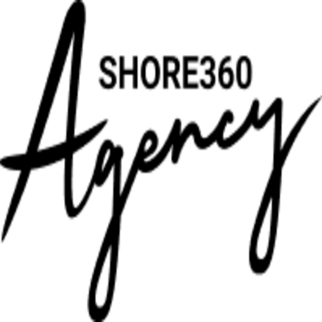

<div align="center" width="100%">
    
</div>

# Agency Uptime

**Internal SRE Monitoring & Status Tool**

Agency Uptime is our customized, high-performance monitoring solution tailored for our SRE team. It features our specific "Agency" branding and optimized workflows.

## 🚀 Quick Start for SREs (Docker)

To deploy Agency Uptime immediately using Docker:

```bash
docker compose up -d
```

The application will be available at `http://localhost:3001`.

## 🎨 Branding Guide

*   **Primary Identity**: Obsidian Blue & Liquid Lava (`#FD7912`)
*   **Status Indicators**: Strict Green (UP) / Red (DOWN) / Orange (WARNING)
*   **Typography**: Roboto Slab (Headers) / Inter (Body)
